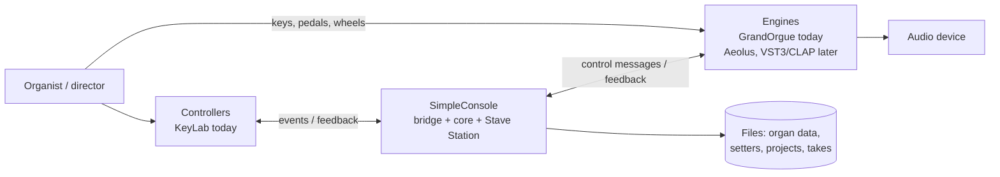

# Architecture

*Status: current state (section 2) is VERIFIED by code reading of `release-2.0` @ `94fea73`; target state (sections 3 to 8) is PROPOSED.*

## 1. System context

Playing (keys, pedal, wheels) goes **controller to engine directly** (GUARDRAILS I-1). SimpleConsole carries control (stops, setters, transport, display), not notes, in the default path.

## 2. Current state (v2.0.x)
- One Python/PySide6 application: `keylab_go_bridge.py` (entry), `qt_gui.py` (3.4k lines), `keylab_bridge/` (bridge, protocol, organ layout, takes, tempo, presets), `midi_stave/` (Stave Station), `lcd_float.py`, themes/translations.
- Fused concerns: `application.py` (BridgeApp, 2.4k lines) mixes controller handling, engine feedback, organ import, setter logic and UI events. `organ_layout.py` holds the Friesach organ as module constants and builds engine paths inside the model. `sessionmeta.MANUALS` fixes four manual slots. Details and counts: INVENTORY-V2.md.
- Good seams already present: `Item` (logical vs wire fields), `odf_scan.py` (organ data from a `.organ`), `PATH_OVERRIDES`, configurable stop channels with spill, a single UI event queue, the controller engage/disengage toggle, Stave Station separate from the bridge.

## 3. Target layering (v3)
```
 +-----------------------------------------------------------+
 | app      GUI (Qt), Textual?, config, plugin loader, wiring |
 +-----------------------------------------------------------+
 | stave    notation / piano roll (depends on core model only)|
 +-----------------------------------------------------------+
 | plugins  controllers/keylab   engines/grandorgue  (aeolus) |  <- never import each other
 +-----------------------------------------------------------+
 | contracts  Engine, Controller, Capabilities, event types   |
 +-----------------------------------------------------------+
 | core     organ model, registrations, session, tempo,       |
 |          actions, focus/menu/bank state machines (stdlib)  |
 +-----------------------------------------------------------+
```
**Dependency rule:** arrows point down only. `core` imports nothing above it and only the stdlib. `contracts` imports `core`. Plugins import `contracts` and `core`, never each other and never `app`. `app` is the only place that knows concrete plugins (via the loader). `stave` may use `core` and the MIDI event type, never an engine or controller.

## 4. The two plugin seams
```
 Controller plugin  --ControlEvent-->  core  --EngineCommand-->  Engine plugin
 (raw MIDI, LCD,     <--Feedback----         <--EngineState-----  (paths, CCs, channels,
  LEDs, DAW port)                                                  process, ODF import)
```
- **Controller seam:** raw device messages become abstract `ControlEvent`s (nav, jog, fader, pad, transport); core sends abstract `Feedback` (text, LED state, bank state) back. The core adapts menus and banking to the controller's **declared capabilities** (faders, LCD size, jog), never to constants.
- **Engine seam:** core issues logical commands (stop on/off by logical id, expression, registration recall, transport); the adapter translates them (GrandOrgue object paths and CC map today). Engines declare capabilities (state read-back yes/no, polyphony, expression, registration steps) and the core degrades gracefully when one is missing.
Full signatures: CONTRACTS.md.

## 5. Runtime model
- **Threads:** MIDI input callbacks (rtmidi) and the take player thread produce events; one UI/event thread owns state. Cross-thread hand-off is by queue only (GUARDRAILS I-7). The take player runs on a dedicated realtime-priority thread (v2 behaviour, keep).
- **Time bases:** stave preview time is at the file's average tempo; session tempo is the single BPM; playback speed = session BPM / file BPM (HANDOFF.md "easy to get wrong"; keep this in `core` as one tempo service).
- **State ownership:** the logical stop/coupler state lives in core. Engines report state when they can; when they cannot (Aeolus is expected to be command-only, UNVERIFIED), the adapter keeps a shadow state and supports a full **resync** command.
- **Failure isolation:** a plugin raising or disconnecting is caught at the seam, reported, and the rest keeps running (I-2).

## 6. Data architecture
| Data | Format today | v3 owner layer | Notes |
|------|--------------|----------------|-------|
| Organ description | Python constants in `organ_layout.py` + `config.yaml` profile | core (logical) + engine plugin (wiring) | v3: YAML/JSON data file per organ, generated by `odf_scan` for GrandOrgue. |
| Setters / combinations | YAML per piece, `Combinations/<organ>/` | core (logical ids) + migration | Existing files must load (I-4). |
| Stave project | `.ss` YAML, links MIDI by path+SHA-1 | stave | Manual names from the organ model, not fixed slots. |
| Takes | MIDI files + sidecars | core session | |
| Settings | `config.yaml`, small `*.txt` files, `go_folder.txt` | app | Precedence: CLI > config.yaml > defaults. |
| GrandOrgue MIDI settings | generated yaml (import/export, merge via `make_go_midi_import.py`) | GrandOrgue plugin | Never import blindly; GrandOrgue Import can clear unmatched objects (README). |

## 7. Packaging constraint that shapes the plugin design
The Windows release is a **Nuitka standalone executable**; bare-name imports need `--include-module` (HANDOFF.md). Dynamic plugin discovery in a frozen build therefore cannot rely on scanning arbitrary Python files. **Decision (PROPOSED, ADR 0007):** v3 plugins are in-tree packages enumerated by an explicit manifest registry included in the build; out-of-tree third-party plugins are deferred until the frozen-build story is proven.

## 8. Quality attributes (in priority order)
1. **Live reliability** - nothing in the app can interrupt playing; fast recovery from port loss.
2. **Correctness of registrations** - what the player cued is what sounds; state sync is visible.
3. **Simplicity for non-specialists** - few concepts, plain language, sensible defaults.
4. **Evolvability** - new organ = data, new engine/controller = plugin.
5. **Portability** - Windows first; Linux/macOS later without rewrite.
6. **Testability** - core and adapters testable without hardware (fake ports, golden files).

## 9. Out-of-process audio hosting (later)
VST3/CLAP hosting is a separate native subsystem (JUCE or a CLAP host) behind the same Engine contract and talking to the Python app over a defined local interface, not a rewrite of the app (ADR 0008). Plugin parameters are not stops; a user-editable learn/mapping layer is required (SCOPE Ring 3).
